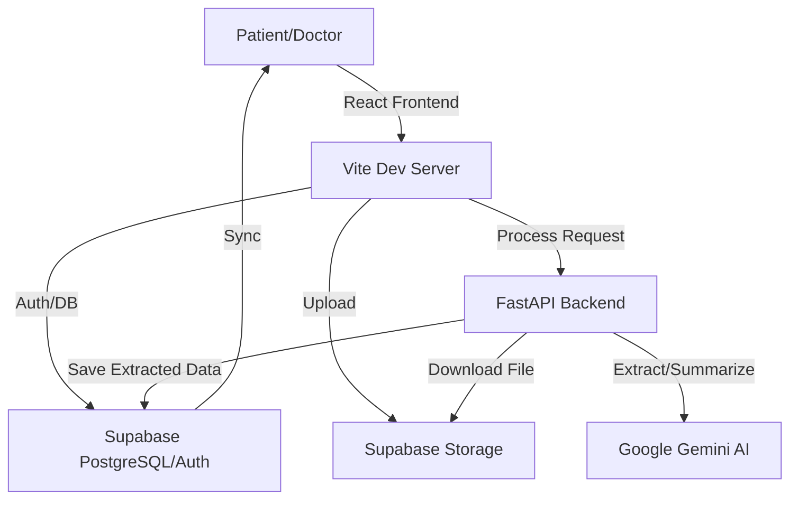

# Medinex — Product Requirements Document (PRD) & Architecture

Medinex is a state-of-the-art, AI-powered healthcare platform designed to bridge the gap between patients and doctors. It digitizes medical history, extracts structured data from medical documents using Gemini AI, and provides clinically relevant health summaries to specialized doctors.

---

## 1. Project Overview
- **Goal**: To provide patients with a single, secure digital home for their medical history and enable doctors to get instant, AI-summarized insights into a patient's health.
- **Problem**: Medical records are often fragmented, paper-based, or locked in disparate systems. Doctors spend too much time reviewing raw files.
- **Solution**: A unified platform with OCR-driven data extraction and AI-driven clinical summarization.

---

## 2. Technical Architecture

### High-Level Flow
1. **Frontend**: React-based UI interacts with Supabase for Auth/Storage and FastAPI for AI processing.
2. **Backend**: FastAPI acts as the AI Orchestrator, communicating with Google Gemini and Supabase.
3. **Database**: Supabase (PostgreSQL) handles all relational data and Row Level Security (RLS).
4. **AI Layer**: Google Gemini 1.5 Flash (via `google-genai` SDK) performs OCR and Summarization.

### Data Flow Diagram (Conceptual)

---

## 3. Technology Stack

### Frontend
- **Framework**: React 18 with Vite (TypeScript)
- **Styling**: TailwindCSS (Modern, Dark-themed aesthetic)
- **Icons**: Lucide-React
- **State/Auth**: Supabase Auth & custom `useAuth` hook
- **Notifications**: React-Hot-Toast

### Backend
- **Framework**: FastAPI (Python 3.10+)
- **AI SDK**: `google-genai` (migration from `google-generativeai`)
- **API Client**: `httpx` (Asynchronous requests)
- **OCR/PDF**: `pypdf`, `Pillow` (for PDF processing)
- **Database Access**: `supabase-py` (Admin client for backend overrides)

### Infrastructure
- **Database**: PostgreSQL (hosted on Supabase)
- **File Storage**: Supabase Storage Buckets (for medical reports)
- **Deployment**: Localhost (Dev), Supabase (Production DB)

---

## 4. Database Schema (Supabase)

| Table | Purpose |
| :--- | :--- |
| `profiles` | Base user data (Patient vs Doctor), city, state, etc. |
| `patient_profiles` | Clinical baseline: DOB, Blood group, Height, Weight, Allergies. |
| `doctor_profiles` | Professional data: License, Specialty, Medical Council, Verification. |
| `connections` | Manage Patient-Doctor access requests (PENDING, ACTIVE). |
| `medical_documents` | File metadata, processing status, and AI-extracted JSON data. |
| `ehr_master` | Aggregated record of all allergies, conditions, and lab highlights. |
| `prescriptions` | Digital prescriptions issued by doctors to connected patients. |
| `master_summaries` | AI-generated health narratives tailored to doctor specialties. |

---

## 5. Core Features & Working Logic

### A. AI Document Extraction Pipeline
1. **Upload**: Patient uploads a report (PDF/Image) to Supabase Storage.
2. **Trigger**: Frontend calls `/documents/extract` on the FastAPI backend.
3. **Processing**:
    - Backend downloads the file using a signed URL.
    - If PDF, it prepares it for Gemini (supports multi-modal input).
    - **Gemini 1.5 Flash** extracts structured JSON (Diagnosis, Meds, Labs).
4. **Aggregation**: Extracted data is merged into the `ehr_master` table to build a lifetime health record.

### B. Specialized Health Summaries
1. **Request**: A doctor views a patient's profile.
2. **Trigger**: Backend calls `/summaries/generate`.
3. **Context Gathering**: Backend pulls:
    - Patient Profile (Self-reported data).
    - EHR Master (AI-extracted data).
    - Active Prescriptions.
4. **AI Generation**: Gemini receives the full context and the doctor's **specialty**.
5. **Output**: A clinical narrative highlighting conditions and alerts most relevant to that specific doctor.

### C. Security & Privacy
- **RLS (Row Level Security)**: Ensures patients only see their own records.
- **Connections**: Doctors can *only* see patient data after a connection is accepted (`status = 'ACTIVE'`).
- **Encrypted Storage**: Files are stored in secure Supabase buckets.

---

## 6. Implementation Status
- [x] Dual-Role Authentication (Patient/Doctor)
- [x] Document Upload & Storage Integration
- [x] AI Extraction Engine (Gemini 1.5 Flash)
- [x] EHR Master Aggregation
- [x] Doctor Specialty Summaries
- [x] Dark-theme Responsive UI
- [ ] Real-time Socket Updates (Currently using Polling)
- [ ] Patient Emergency Contacts (Removed per latest requirement)

---

**Generated by Antigravity AI**
